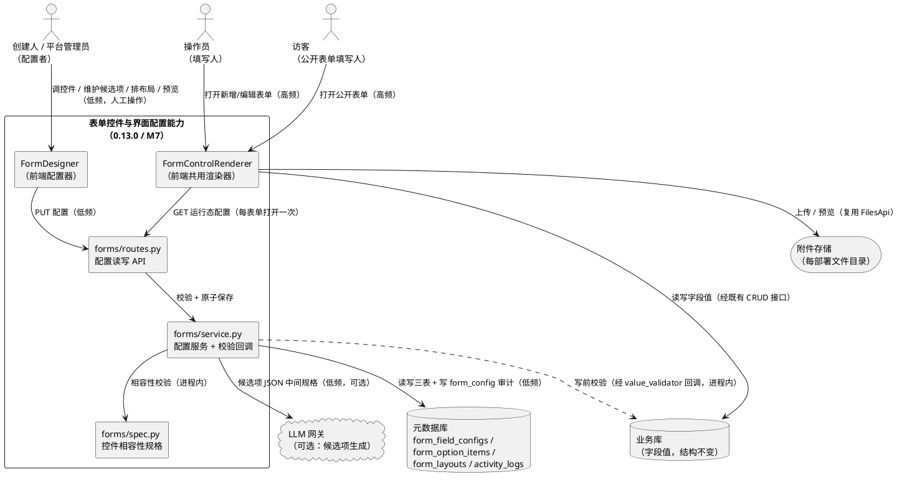
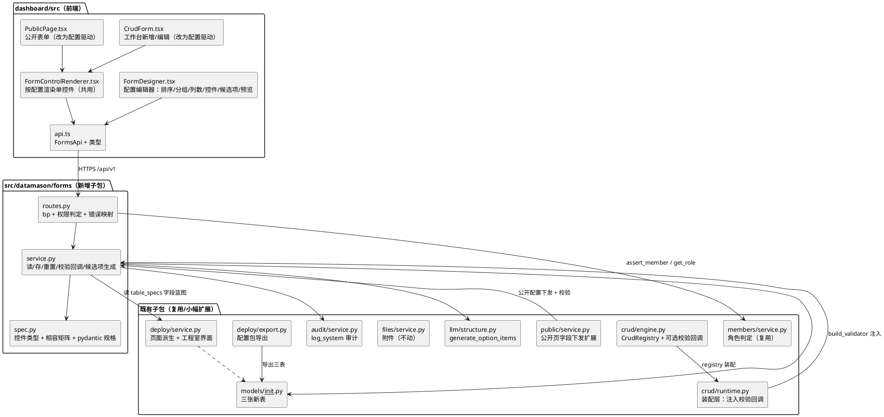
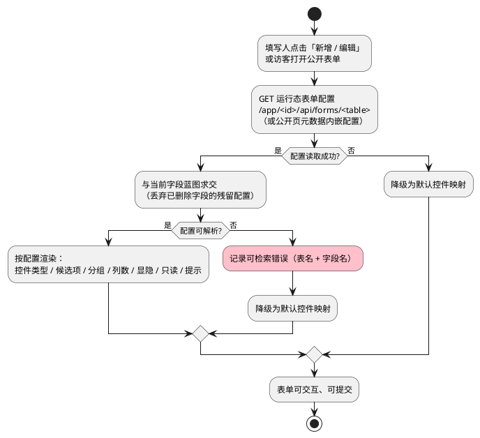
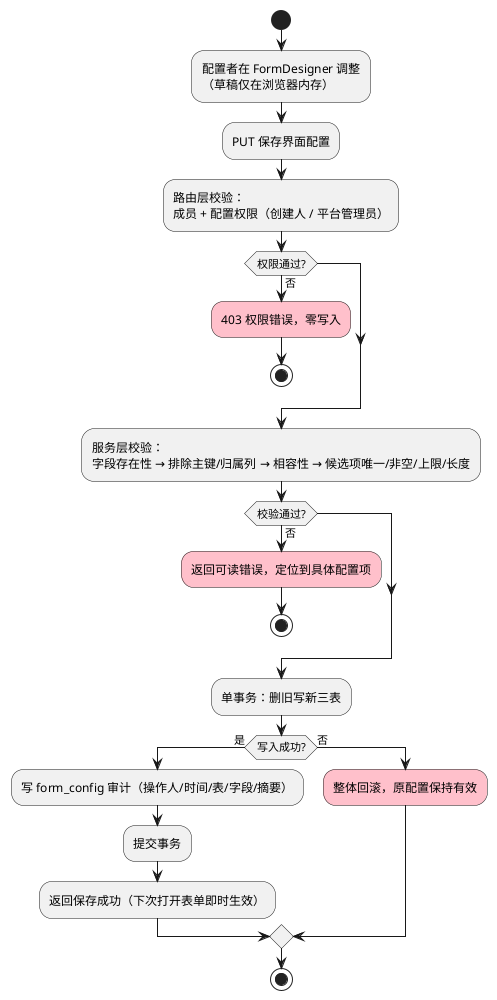
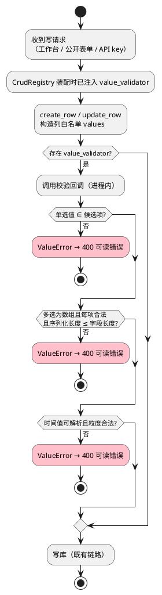
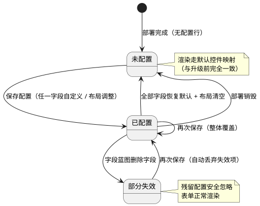
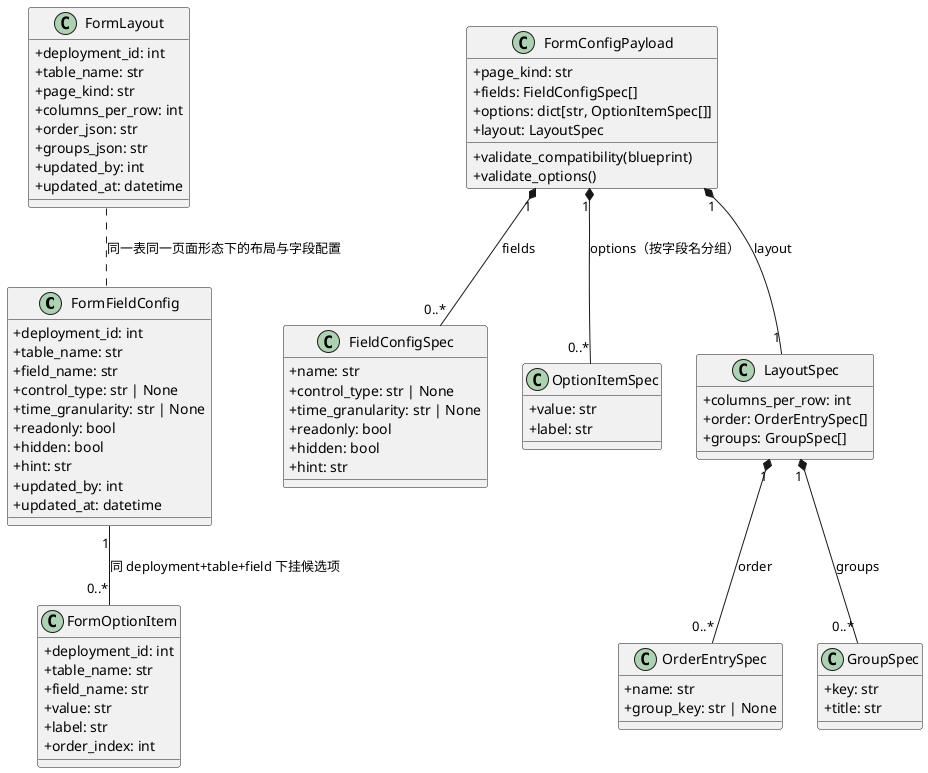

# DataMason 0.13.0 技术方案与实现闭环 — 表单控件能力与交互界面表单调整

> **需求来源**：`docs/规划/0.13.0/DataMason-0.13.0-需求规格.md`（等价主件 `.codeartsdoer/specs/form_controls_ui/spec.md`）。
> **基线**：0.12.0（M6 混合建库已交付）；本设计对应里程碑 **M7（0.13.0）**。
> **视角**：技术方案（How）。需求（What）见需求规格；任务拆分见同目录《开发计划》。
> **纪律约束**：LLM 只产 JSON 中间规格，DDL / 建库 / 页面由 Python 确定性映射；不新增前端运行时依赖；不引入 alembic；不动业务库结构（本版本**零 DDL**）；交付线为离线 `pytest` 全绿 + `npm --prefix dashboard run build` 通过。

---

# 一、需求与存量功能关系分析

本篇章明确「表单控件与界面配置」这一新需求与 0.12.0 存量代码的关系，是增量设计的事实基础。所有代码位置引用以当前仓库为准（`E:\coding\Mason\DataMason`）。

## 1.1 需求功能与存量功能对比

### 1.1.1 已实现功能

需求中可由存量代码**直接复用**（完全匹配或高度相似）的部分如下。匹配度四档：100%（语义与行为一致，可直接复用）、75%（主体一致，需小幅适配或补充）、50%（部分可用，需较大改造）、25%（仅思路可借鉴）。

| 需求功能 | 存量功能 | 代码位置 | 匹配度 |
|---------|---------|---------|--------|
| 字段数据类型白名单（供控件相容性判定） | 三方言逻辑类型白名单 `ColumnType`（INTEGER/BIGINT/VARCHAR/TEXT/BOOLEAN/DATETIME/DECIMAL/FILE） | `src/datamason/ddl/table_spec.py:16-18` | 100% |
| 默认控件映射（数字→数字框、长文本→多行、布尔→是否、外键→关联下拉、附件→附件控件） | `CrudForm.renderWidget` 按 `baseType(col.type)` 分支渲染；`col.fk` 优先关联下拉 | `dashboard/src/pages/workspace/CrudForm.tsx:169-199` | 100% |
| 关联选择控件（远程搜索 + 初始值回填） | `FkSelect`：`CrudApi.refs` 分页搜索，初始值不在候选中时前置合并 | `dashboard/src/pages/workspace/CrudForm.tsx:26-96` | 100% |
| 附件上传 / 预览 / 移除 | `save_upload` / `remove_attachment` / `get_attachment` + `FileField` 控件 | `src/datamason/files/service.py:76-171`、`dashboard/src/pages/workspace/CrudForm.tsx:243-300` | 100% |
| 附件安全（扩展名 + MIME 白名单、大小上限、路径穿越防护、不信任客户端 Content-Type） | `server_mime` / `_allowed_exts` / `_allowed_mimes` / `_within_data_root` | `src/datamason/files/service.py:45-74, 88-104` | 100% |
| 附件引用值格式（`[{token,name}]` JSON 串）与解析 | `parseFileValue` 解析 JSON 串为附件项数组 | `dashboard/src/components/FileChip.tsx` | 100% |
| 工作台表单元数据下发（业务名 / 归属列标记 / 长度 / 类型语义还原） | `app_meta` 以 `table_specs.columns_json` 富化 `crud_engine.get_meta` 结果 | `src/datamason/workspace/routes.py:204-244` | 100% |
| 公开表单元数据下发（字段白名单，排除主键与归属列） | `public.get_page` 过滤 `is_ownership` / `is_pk` | `src/datamason/public/service.py:49-78` | 100% |
| CRUD 写路径（列白名单 + 类型还原 + 归属列注入） | `create_row` / `update_row` / `_coerce_value` | `src/datamason/crud/engine.py:127-152, 322-399` | 100% |
| 时间值的服务端解析（ISO 日期时间 / 日期串） | `_coerce_value` 用 `datetime.fromisoformat` 解析 DATETIME/DATE/TIMESTAMP | `src/datamason/crud/engine.py:132-147` | 100% |
| 必填校验（公开表单，服务端复核） | `public.submit` 对 NOT NULL 业务列做业务名提示校验 | `src/datamason/public/service.py:96-106` | 100% |
| 唯一性校验（前端预校验） | `CrudForm.checkUnique` 按列值查重 | `dashboard/src/pages/workspace/CrudForm.tsx:124-136` | 100% |
| 主键与归属列保护 | 归属列注入 `inject_ownership_columns`；写路径禁改归属列与主键 | `src/datamason/ddl/ddl_builder.py`、`src/datamason/crud/engine.py:327-340` | 100% |
| 页面规格确定性派生（每表 `crud_list`，留言/反馈类表追加 `public_form`） | `_derive_pages` | `src/datamason/deploy/service.py:185-206` | 100% |
| 两阶段操作日志 + 系统动作日志 | `AuditSession.begin/commit/abort`、`log_system`、`reconcile_pending` | `src/datamason/audit/service.py:61-152, 399-460` | 100% |
| 配置包导出（部署元信息 + 表/页面/菜单/流程 + crud_configs + 全量 committed 日志） | `build_package` | `src/datamason/deploy/export.py:41-186` | 100% |
| 元数据库惰性建表 + 缺列回填（无 alembic 的 schema 演化） | `create_all_lazy` + `_backfill_missing_columns` | `src/datamason/models/__init__.py:335-397` | 100% |
| 前端 API 单文件集中（类型 + 分组同文件声明） | `http` axios 实例 + `CrudApi` / `FilesApi` / `EngineerApi` 等分组 | `dashboard/src/api.ts` | 100% |
| LLM 网关与 JSON 中间规格（含容错解析、重试、统一埋点） | `OpenAiCompatibleClient.chat_json`、`_loads_llm_json`、`MAX_RETRY=2`、`ai_service.record` | `src/datamason/llm/client.py:41`、`src/datamason/llm/structure.py`、`src/datamason/ai/service.py` | 100% |
| 三层角色 + 按人授权（供配置权限判定复用） | `get_role` / `assert_member` / `require_role` / `table_access_map` | `src/datamason/members/service.py:43-90` | 100% |
| 工程室「界面与菜单」页面卡（页面清单 + 缩略预览 + 拖拽入树） | `EngineerMenusPage` + `EngineerApi.interfaces` | `dashboard/src/pages/workspace/EngineerMenusPage.tsx:195-275, 758-879`、`src/datamason/deploy/service.py:831-875` | 75% |
| 页面卡「调整」（当前仅改页面标题） | `update_page_title` + `EngineerApi.updatePageTitle` | `src/datamason/deploy/service.py:1015-1037`、`dashboard/src/api.ts:767-771` | 50% |
| 表单渲染入口（工作台新增/编辑抽屉） | `CrudForm`：Drawer + Form，按 `editable` 过滤主键与归属列 | `dashboard/src/pages/workspace/CrudForm.tsx:99-241` | 75% |
| 公开表单渲染入口 | `PublicPage` + `renderControl` | `dashboard/src/pages/PublicPage.tsx:18-178` | 75% |

> 说明：`CrudForm` / `PublicPage` 的渲染入口虽然存在，但其控件选择逻辑是**硬编码类型分支**，无法承载"配置驱动"的渲染语义，故匹配度记 75%；工程室页面卡的「调整」当前只能改标题，故记 50%。

### 1.1.2 需要扩展的功能

需求与存量代码**部分匹配**，须在既有链路上改造。差异说明聚焦输入输出、业务逻辑与边界条件；扩展方向给出改造范围、新增依赖与兼容性风险。

| 需求功能 | 存量功能 | 差异说明 | 扩展方向 |
|---------|---------|---------|---------|
| 表单按界面配置渲染（控件类型 + 候选项 + 布局） | `CrudForm.renderWidget` 按字段类型硬编码分支 | **输入差异**：现仅吃 `MetaColumn[]`，缺控件配置与候选项；**逻辑差异**：无单选/多选/日期时间控件，无分组/列数/显隐/只读/提示；**边界差异**：无"配置缺失降级"路径 | 抽出独立渲染组件 `FormControlRenderer`，`CrudForm` 改为"取配置 → 按配置渲染 → 默认映射兜底"；渲染入参新增可选的表配置载荷，缺失时行为与升级前**完全一致** |
| 公开表单按公开布局渲染 | `PublicPage.renderControl` 独立硬编码分支 | 同上；且公开表单需**单独可控**的字段顺序/分组/显隐 | 复用同一 `FormControlRenderer`；公开页元数据扩展返回"公开布局"，仅含该页允许公开的字段与其候选项 |
| 工作台表单元数据下发携带界面配置 | `app_meta` 只下发列元数据与动作权限 | **输出差异**：响应无控件配置/候选项/布局 | 新增**独立只读接口** `/forms/<table>`（单表配置），不改 `app_meta` 响应结构，避免影响既有消费者（API key 通道、导入向导、页面卡缩略预览） |
| 服务端候选值合法性校验 | `create_row` / `update_row` 只做列白名单 + 类型还原 | **逻辑差异**：无"提交值 ∈ 候选项集合"校验，无多选数组校验，无序列化长度校验；**边界差异**：绕过前端直接提交非法载荷目前会成功入库 | 在 `CrudRegistry` 增加可选 `value_validator` 回调（依赖倒置），由 `runtime` 装配层注入 `forms` 服务校验函数；**所有写路径**（工作台 / 公开表单 / API key）统一生效 |
| 工程室页面卡「调整」→ 打开表单编辑器 | `update_page_title` 仅改标题 | **交互差异**：页面卡目前无表单配置入口 | 页面卡「调整」扩展为打开 `FormDesigner`；标题调整保留在编辑器内一并提交；不改变既有菜单树拖拽链路 |
| 配置包导出携带界面配置 | `build_package` 导出 page_specs / crud_configs | **输出差异**：无表单配置、候选项、布局三节 | `export.py` 新增三节 + `counts`；导出时若配置序列化失败则报错中止（对齐需求 §5.4.3 异常 2）；`EXPORT_VERSION` 保持 1（新增可选节，旧消费者忽略） |
| 元数据库承载界面配置 | 无表单配置相关模型 | **结构差异**：缺三张配置表 | 新增 `form_field_configs` / `form_option_items` / `form_layouts` 三表，由 `create_all_lazy(checkfirst=True)` 自动建表，**无需回填逻辑**（新表无存量数据） |
| 配置变更审计 | `log_system` 现有 action：`deploy`/`structure`/`member`/`flow`/`import`/`apikey` | **逻辑差异**：无表单配置专属动作，日志页动作筛选无该项 | 新增 `action="form_config"`（11 字符，`activity_logs.action` 为 `String(16)` 可容纳）；日志页动作筛选项补一项 |
| 表单配置权限判定 | `_require_creator` 仅创建人（DR-14，管理员无工程室能力） | **逻辑差异**：需求 §4.3.1 要求"仅创建人与平台管理员可读写" | 新增 `_require_form_config`：部署 owner/creator **或** 平台管理员（`users.is_platform_admin`）；**不**放宽既有 `_require_creator`，避免影响其他工程室动作 |

### 1.1.3 需要新增的功能或接口

以下为存量代码中**完全没有对应实现**的部分，按模块分组。每项给出输入、输出与核心逻辑，并标注依赖关系。

#### A. 领域规格层（新增 `src/datamason/forms/spec.py`）

纯领域、无 Flask 依赖，承载强校验（pydantic 2），对齐 `src/datamason/ddl/table_spec.py` 的既有风格。

1. **控件类型枚举**：`CONTROL_TYPES = ("text", "textarea", "number", "boolean", "radio", "checkbox", "date", "datetime", "ref", "file")`，共 10 种，与需求 §5.2.1 第 1 条一一对应。
   - 输入：无。输出：控件类型常量元组。
2. **相容性矩阵**：`CONTROL_COMPAT: dict[str, frozenset[str]]`，键为字段数据类型，值为该类型允许的控件类型集合。
   - 核心逻辑：`file` 仅对 `FILE`；`ref` 仅对存在外键的字段；`date`/`datetime` 对 `DATETIME` 与 `VARCHAR`；`radio`/`checkbox` 对 `INTEGER`/`BIGINT`/`DECIMAL`/`VARCHAR`/`TEXT`/`BOOLEAN`；`number` 对 `INTEGER`/`BIGINT`/`DECIMAL`；`text`/`textarea` 对字符串族；`boolean` 仅对 `BOOLEAN`。
   - 输入：字段数据类型 + 是否外键。输出：允许的控件类型集合。
3. **配置载荷规格**：`FieldConfigSpec` / `OptionItemSpec` / `LayoutSpec` / `FormConfigPayload`（pydantic 模型），承载全部约束（唯一性、长度上限、数量上限、枚举、只读/隐藏）。
   - 输入：前端提交的配置 JSON。输出：校验后的规格对象，或 `ValidationError`。
4. **相容性校验函数**：`assert_control_compatible(data_type, control_type, *, is_fk)`。
   - 依赖：无。

#### B. 领域服务层（新增 `src/datamason/forms/service.py`）

自由函数（非类），以 `app` 为首参，从 `app.extensions` 取会话，对齐既有服务风格。

1. **`get_form_config(app, deployment_id, table_name, *, page_kind)`**：读某表某页面形态的完整界面配置。
   - 输入：部署 id、表名、页面形态（`crud_list` / `public_form`）。输出：`{fields: [...], options: {field: [...]}, layout: {...}, degraded: bool}`。
   - 核心逻辑：读三表 → 与当前字段蓝图求交（丢弃已删除字段的残留配置）→ 按默认映射补齐未配置字段 → 任一步异常则整体降级为默认（`degraded=True`）。
2. **`save_form_config(app, deployment_id, table_name, payload, *, page_kind, actor_user_id)`**：原子保存界面配置。
   - 输入：配置载荷、操作人。输出：保存结果摘要。
   - 核心逻辑：权限已由路由层校验 → 校验字段存在性（对照 `table_specs.columns_json`）→ 排除主键与归属列 → 相容性校验 → 候选项唯一/非空/数量/长度校验 → **单事务**内删旧写新三表 → 写 `form_config` 审计 → 返回。
   - 依赖：`src/datamason/forms/spec.py`、`src/datamason/audit/service.py`、`src/datamason/models`。
3. **`reset_field_config(app, deployment_id, table_name, field_name, *, actor_user_id)`**：恢复某字段默认。
   - 核心逻辑：删除该字段的配置行与候选项行，写审计。
4. **`build_validator(app, deployment_id, table_name, *, page_kind)`**：构造写路径校验回调。
   - 输出：`Callable[[dict], None]`，抛 `ValueError`（业务可读消息）。
   - 核心逻辑：闭包内一次读取该表配置，对提交载荷逐字段校验：单选值 ∈ 候选项、多选为数组且每项 ∈ 候选项且序列化长度 ≤ 字段长度、时间值可解析且粒度合法。
5. **`generate_option_items(app, *, field_label, description)`**（可选能力）：NL → 候选项候选清单。
   - 核心逻辑：调 `src/datamason/llm/structure.generate_option_items` → 确定性去重/裁剪 → 埋点 → **仅返回清单，不写配置**（需求 §5.2.1 第 4 条）。
   - 依赖：`src/datamason/llm/`、`src/datamason/ai/service.py`。

#### C. HTTP 路由层（新增 `src/datamason/forms/routes.py`）

薄路由：解析 → 取 `session["user_id"]` → 权限校验 → 调服务（传 `current_app` 为首参）→ `jsonify`；模块自定义 `FormConfigError` + `@bp.errorhandler` 映射 HTTP。

1. `GET /api/v1/deployments/<id>/forms/<table>`：读工作台表单配置（配置者）。
2. `PUT /api/v1/deployments/<id>/forms/<table>`：保存工作台表单配置（配置者）。
3. `DELETE /api/v1/deployments/<id>/forms/<table>/fields/<field>`：恢复单字段默认（配置者）。
4. `GET /api/v1/app/<id>/api/forms/<table>`：**运行态只读**配置（任意成员，供表单渲染；操作员/访客亦需读取以正确渲染）。
5. `POST /api/v1/deployments/<id>/forms/<table>/fields/<field>/options/generate`：NL 生成候选项（配置者，可选能力）。
6. 公开表单配置随既有 `GET /api/v1/public/<id>/pages/<page_id>` 一并下发（**不新增匿名接口**，满足 §4.3.2 最小暴露）。

#### D. LLM 生成层（扩展 `src/datamason/llm/structure.py`）

1. **`generate_option_items(client, *, field_label, description, max_items=200)`**：产出候选项 JSON 中间规格。
   - 输出：`(list[{value, label}], meta)`；失败回喂重试上限沿用 `MAX_RETRY=2`。
   - 纪律：**只产 JSON 中间规格**，不落库、不产配置。

#### E. 前端渲染层（新增 `dashboard/src/components/FormControlRenderer.tsx`）

1. **`FormControlRenderer`**：按字段配置渲染单个控件，工作台与公开表单**共用**。
   - 输入：字段元数据、字段配置、候选项、当前值、只读/禁用态、变更回调。
   - 输出：antd 控件元素（`Input`/`Input.TextArea`/`InputNumber`/`Select`/`Radio.Group`/`Checkbox.Group`/`DatePicker`/`FkSelect`/`FileField`）。
   - 核心逻辑：`control_type` 为空 → 走既有默认映射；单选/多选 → 候选项驱动；`date`/`datetime` → `DatePicker`（`showTime` 由粒度决定）；`file` → 复用既有 `FileField`。
   - 复用：从 `CrudForm` 抽出 `FkSelect` 与 `FileField` 到该组件模块（**行为不变**），`CrudForm` 改为引用。

#### F. 前端配置层（新增 `dashboard/src/pages/workspace/FormDesigner.tsx`）

1. **`FormDesigner`**：表单编辑器（Modal 或 Drawer，挂在工程室页面卡「调整」）。
   - 输入：部署 id、表名、页面形态、当前配置。
   - 输出：配置保存请求。
   - 核心逻辑：字段列表（可拖拽排序）→ 分组管理 → 列数选择 → 逐字段控件类型下拉（**仅列出相容项**）→ 候选项表格（增删改排序，实时校验唯一/非空/上限 200）→ 显隐/只读开关 → 提示文案 → **实时预览区**（复用 `FormControlRenderer`，所见即所得）→ 保存。
   - 草稿：仅在浏览器内存维护，**保存才落库**（满足 §5.4.1 第 7 条"草稿不泄漏"）。

#### G. 前端 API 层（扩展 `dashboard/src/api.ts`）

1. **`FormsApi`** 分组 + 类型（`FormFieldConfig` / `FormOptionItem` / `FormLayout` / `FormConfigPayload` / `FormConfigResponse`）。
2. `PublicPageMeta` 扩展 `layout` 与 `options` 字段（公开页专用子集）。

#### H. 应用装配层（扩展 `src/datamason/app.py`）

1. 注册 `forms.bp`，URL 前缀 `/api/v1`（与 `deploy.bp` 同前缀，路由内自带完整路径）。
2. 鉴权守卫白名单**不变**（配置接口需登录，公开表单沿用 `/api/v1/public/*` 匿名放行）。

## 1.2 存量功能详细分析

对 1.1.1 中被复用/扩展的关键存量功能做深入解读，作为增量设计的接口契约依据。

### 1.2.1 `CrudForm` 渲染与提交契约

- **接口契约**：入参 `{deploymentId, table, meta: MetaColumn[], pkName, initial, open, onClose, onSaved}`（`dashboard/src/pages/workspace/CrudForm.tsx:10-19`）。`meta` 由父组件 `CrudListPage` 从 `CrudApi.meta` 取得并透传（`dashboard/src/pages/workspace/CrudListPage.tsx:83-90, 382-385`）。
- **业务规则**：可编辑字段 = `meta` 中非归属列且非主键（`CrudForm.tsx:113-116`）；提交载荷过滤空值（`undefined`/`null`/空串不提交，`CrudForm.tsx:138-146`）；校验规则由 `nullable`（必填）、`VARCHAR + length`（最大长度）、`unique`（远程查重）三者合成（`CrudForm.tsx:218-226`）。
- **扩展点**：`renderWidget(col)` 是**唯一**的控件决策点，可被"配置驱动 + 默认兜底"整体替换；`Form.Item` 的 `rules` 组装点是校验扩展位（多选序列化长度校验应挂此处）。
- **约束**：`editable` 已排除主键与归属列，与需求 §5.3.9 一致，**无需改动**该过滤逻辑；表单为 `layout="vertical"` 单列，列数/分组需在外层引入栅格容器。

### 1.2.2 CRUD 写路径契约

- **接口契约**：`create_row(registry, name, audit=None) -> {id}`、`update_row(registry, name, pk, audit=None) -> {updated}`；载荷从 `request.get_json()` 读取（`src/datamason/crud/engine.py:322-399`）。
- **业务规则**：列白名单——不在反射 schema 内的键**静默忽略**；归属列与主键**禁止客户端写入**；`_coerce_value` 按列类型还原（DATETIME 支持 ISO 串与 HTTP 日期串、INT 转 int、BOOL 宽容识别）（`src/datamason/crud/engine.py:127-152`）。
- **扩展点**：`CrudRegistry.__init__` 是装配点，可注入可选校验回调；`values` 构造完成后、写库前是**唯一的统一校验位**（三条写路径共用此函数，故校验只需加一次）。
- **约束**：`src/datamason/crud/` 为纯领域层，**不得 import 蓝图或 request 之外的东西**；校验依赖元数据库配置，必须靠**回调注入**而非在 engine 内直接查库。异常语义：校验失败应抛 `ValueError`（路由层映射 400），不得抛 `HTTPException`（避免领域层依赖 werkzeug 异常语义）。

### 1.2.3 表单元数据下发契约

- **接口契约**：`GET /api/v1/app/<id>/api/meta` 返回 `{表名: {columns: MetaColumn[], actions?: string[], data_scope?: string}}`（`src/datamason/workspace/routes.py:204-244`）。
- **业务规则**：类型语义以 `table_specs.columns_json` 为准（SQLite 反射会把 BOOLEAN 丢成 INTEGER，故用规格覆盖）；`biz_name` 缺省回退字段名；操作员按授权表收窄并附动作集合。
- **扩展点**：`app_meta` 的响应体被 `CrudListPage`、`EngineerMenusPage`（页面卡缩略）、`ImportWizard` 等多处消费，**不宜扩字段**；表单配置走**独立接口**更安全。
- **约束**：操作员仅可见被授权表——配置读取接口必须复用 `member_service.assert_member` 做成员校验，避免越权读配置（需求 §5.4.3 异常 3）。

### 1.2.4 附件服务契约

- **接口契约**：`save_upload(app, deployment_id, file_storage, *, table_name, row_pk, field_name, uploaded_by) -> dict`（`src/datamason/files/service.py:76-116`）；`FilesApi.upload` 以 `FormData` 提交并可携带 `table/row_pk/field` 元信息（`dashboard/src/api.ts:531-545`）。
- **业务规则**：先按扩展名绑定 MIME 并过白名单，**再落盘**（避免留孤儿文件）；单文件上限默认 10 MB，超限在读取后拒绝；token 随机命名，路径必须落在 `DATA_ROOT` 内。
- **扩展点**：`FileField` 组件的 `beforeUpload` 可做**前置**大小/扩展名校验（需求 §4.1.4 要求"前置提示，不发起上传"）。
- **约束**：`FILE` 列只存 `[{token,name}]` JSON 串（多附件）或 token（单附件），**二进制不进业务库**；移除附件调用 `FilesApi.remove` 会**删除附件记录与磁盘文件**，与需求 §4.2.5「移除仅解除引用、不误删仍被引用的附件」存在差异——本版本需在**前端**改为"仅从字段值移除引用"（见 §2.1.3 决策 D-4）。

### 1.2.5 公开表单提交契约

- **接口契约**：`GET /api/v1/public/<id>/pages/<page_id>` 返回 `{deployment_id, biz_name, page_id, title, kind, table, fields: PublicField[]}`；`POST .../submit` 提交载荷（`src/datamason/public/service.py:64-114`、`dashboard/src/api.ts:893-907`）。
- **业务规则**：仅 `access=public` 且 `kind=public_form` 开放；部署须 `running`；归属列记 `VISITOR_ACTOR_ID=0`（日志显示"系统"）；必填校验按 NOT NULL 业务列给出业务名提示。
- **扩展点**：`_field_columns(ts)` 是字段下发的唯一出口，可在此按"公开布局"过滤/排序并附加控件配置与候选项。
- **约束**：**最小暴露**——只下发该页字段，禁止任何其他表信息（需求 §4.3.2）；匿名路径**不可**暴露配置写入能力。

### 1.2.6 页面规格与工程室界面卡契约

- **接口契约**：`_derive_pages` 每表派生一张 `crud_list`，名字含留言/反馈类关键词时追加一张 `public_form`（`src/datamason/deploy/service.py:185-206`）；`get_interfaces` 返回菜单树 + 页面卡 + 授权菜单 + 入口路径（`src/datamason/deploy/service.py:831-875`）。
- **业务规则**：页面 `kind ∈ {crud_list, public_form, dashboard, flow}`；`page_specs.layout_json` **已被 dashboard 占用**（`src/datamason/qa/service.py:459-478` 写入图表规格），故**不可**复用于表单布局（见 §2.1.3 决策 D-2）。
- **扩展点**：`PageCard` 组件的「调整」按钮当前只调 `updatePageTitle`（`EngineerMenusPage.tsx:415-434`），可扩展为打开 `FormDesigner`。
- **约束**：工程室动作 `_require_creator` 仅创建人（`src/datamason/deploy/routes.py:575-583`）；新增配置权限判定须**独立**实现，不修改该函数。

---

# 二、增量设计方案

本篇章把需求转化为可落地的技术方案：先整体（实现模型）后局部（接口 / 数据模型），每个决策附带选择理由。

## 2.1 实现模型

### 2.1.1 上下文视图

展示本组件与外部（配置者、填写人、元数据库、业务库、附件存储、LLM 网关）的交互关系。节点只显示接口名称，标注协议与调用频率。



**协议与频率说明**：配置读写为 HTTPS/JSON、低频（人工操作，需求 §4.1.2 要求 ≤ 1 秒）；运行态配置读取为 HTTPS/JSON、每次打开表单一次（需求 §4.1.1 要求表单首屏 ≤ 1.5 秒）；写前校验为**进程内函数调用**（不引入额外 RTT）；候选项生成为 HTTPS、低频且可选。

### 2.1.2 服务/组件总体架构

展示模块内部组成、职责与依赖方向（依赖向内：传输层 → 领域服务 → 纯领域规格 → 模型）。



**模块划分与职责**：

| 模块 | 职责 | 不拥有 |
|------|------|--------|
| `src/datamason/forms/spec.py` | 控件类型常量、相容矩阵、配置载荷 pydantic 规格与校验函数 | Flask、DB、LLM |
| `src/datamason/forms/service.py` | 配置读/存/重置、字段蓝图求交、降级、写前校验回调、候选项生成编排 | HTTP 解析、角色判定 |
| `src/datamason/forms/routes.py` | 参数解析、成员/权限校验、错误码映射 | 业务规则、SQL |
| `dashboard/src/components/FormControlRenderer.tsx` | 单控件渲染（含候选项、时间粒度、附件） | 配置读写、页面状态 |
| `dashboard/src/pages/workspace/FormDesigner.tsx` | 配置编辑交互 + 实时预览（草稿仅内存） | 直接 HTTP（统一走 `api.ts`） |

**配置项与取值策略**：控件类型白名单与相容矩阵**硬编码于 `spec.py`**（确定性、可审计、不随环境漂移）；候选项数量上限 200、提示文案 ≤ 200 字符、分组数 ≤ 20、分组名 ≤ 50 字符、每行列数 ∈ {1,2,3} 均为规格常量（对齐需求 §6）；附件大小上限沿用既有 `DM_UPLOAD_MAX_FILE_BYTES`（默认 10 MB）。

### 2.1.3 实现设计文档

#### 决策清单（每项附选择理由）

| 编号 | 决策 | 选择理由 | 被否方案 |
|------|------|---------|---------|
| D-1 | 新增独立子包 `src/datamason/forms/`（`spec.py` + `service.py` + `routes.py`） | 配置读写与校验是**独立领域能力**，被工作台、公开表单、API key、导出、工程室五处复用；独立子包符合 §5 模块边界且避免在 `deploy` 内堆叠 | ① 塞进 `src/datamason/deploy/`（职责混淆）；② 塞进 `src/datamason/crud/`（crud 为纯领域且需保持无元数据库依赖） |
| D-2 | 新增 `form_layouts` 表存布局，**不复用** `page_specs.layout_json` | `layout_json` 已被 dashboard 占用（`src/datamason/qa/service.py:459-478`），复用它会造成"同列不同 kind 语义混杂"，且 dashboard 代码按内容匹配表名（`src/datamason/qa/service.py:308`）存在误判风险 | 复用 `page_specs.layout_json`（语义冲突）、复用 `crud_configs.ui_config_json`（crud_configs 为表级非页面形态级，无法区分工作台/公开表单） |
| D-3 | 三表主键用 `(deployment_id, table_name, field_name)` **字符串三元组**，不外键到 `table_specs.id` | 需求 §5.4.1 第 2 条要求"配置与字段蓝图解耦"；结构演化可能重建 `table_specs` 行（`src/datamason/deploy/structure.py:233`），用字符串引用可**天然抗演化**，字段被删时残留配置"安全忽略" | 外键到 `table_specs.id`（结构演化后 id 漂移导致配置错位） |
| D-4 | 附件"移除"改为**仅移除字段值引用**，不调用 `FilesApi.remove` | 需求 §4.2.5 要求"不得误删仍被其他记录引用的附件"；既有 `remove_attachment` 会删记录与磁盘文件（`src/datamason/files/service.py:153-171`），存在误删风险。本版本改为前端仅改字段值，遗留附件由既有 `mark_orphans_pending` / `cleanup_orphans` 回收链路处理 | 沿用 `FilesApi.remove`（违反 §4.2.5） |
| D-5 | 写前校验用 `CrudRegistry.value_validator` **回调注入** | 三条写路径（工作台 / 公开表单 / API key）共用 `create_row`/`update_row`，回调注入保证"服务端统一校验"（需求 §4.3.3）且 crud 保持纯领域（不 import 元数据库） | 在各路由层分别校验（API key 通道易漏、重复三处） |
| D-6 | 运行态配置走**独立只读接口** `/app/<id>/api/forms/<table>`，不扩 `app_meta` | `app_meta` 响应被列表页、页面卡缩略、导入向导多处消费，扩字段有回归风险；独立接口体积可控且**配置保存后即时生效**（每次打开表单重新拉取） | 并入 `app_meta`（响应膨胀 + 缓存失效复杂） |
| D-7 | 配置权限 = 部署 owner/creator **或** 平台管理员 | 对齐需求 §4.3.1"仅创建人与平台管理员"；`_require_creator` 保持不变，避免影响其他工程室动作（DR-14） | 放宽既有 `_require_creator`（影响面过大） |
| D-8 | 预览由前端复用 `FormControlRenderer` 实现，**不做服务端预览接口** | 需求 §5.2.1 第 6 条要求"预览与实际表单渲染一致"——同一组件渲染是**最强一致性保证**；服务端预览需重写一套渲染语义，必不一致 | 服务端返回预览 HTML（语义双写、必然漂移） |
| D-9 | 配置保存采用"**单事务内删旧写新**" | 需求 §4.2.1 要求原子性，禁止部分生效；三表在同一元数据库会话内提交，失败整体回滚 | 增量 diff 更新（分支多、易漏、原子性难保证） |
| D-10 | 配置变更审计新增 `action="form_config"` | `activity_logs.action` 为 `String(16)`，"form_config" 11 字符可容纳；独立动作便于日志页筛选（需求 §4.4.2 可观测） | 复用 `structure`（与结构变更混淆，无法区分"改结构"与"改呈现"） |
| D-11 | `EXPORT_VERSION` 保持 1，新增三节为**可选节** | 导出格式向后兼容（旧消费者忽略未知节），避免版本升级引发的兼容判断 | 升为 2（需消费者同步升级，无收益） |
| D-12 | 候选项 NL 生成走既有 LLM 网关 + `ai_service.record` 埋点，`kind="options"` | 对齐"LLM 只产 JSON 中间规格"纪律与统一埋点要求（`src/datamason/ai/service.py`）；`kind` 列无枚举约束，新增值安全 | 新起一套 LLM 调用链（重复造轮子） |

#### 流程一：表单渲染（含降级）



**分支触发条件与处理策略**：配置读取失败或解析异常 → 降级默认映射并保持可提交（需求 §4.2.3 / §5.4.1 第 6 条，**禁止白屏或阻断录入**）；配置与字段蓝图不匹配 → 忽略失效项，其余正常生效（需求 §4.5.3 / §5.1.3 异常 2）；候选项集合为空但字段被配为单选/多选 → 降级为普通文本输入并提示（需求 §5.1.3 异常 1）。

#### 流程二：配置保存（原子 + 审计）



**事务设计**：三表（`form_field_configs` / `form_option_items` / `form_layouts`）与审计记录在**同一元数据库会话**内操作；任一环节异常则 `rollback`，保证"要么全生效、要么全不生效"（需求 §4.2.1）。审计写入采用既有 `log_system`（已 committed 语义），不引入两阶段复杂度（配置变更非业务数据写入）。

#### 流程三：写路径服务端校验（回调注入）



**扩展点设计**：`CrudRegistry.value_validator` 默认为 `None`（存量行为**完全不变**）；由 `src/datamason/crud/runtime.py` 在 `_registry` / `registry_for_service` 装配时注入，`src/datamason/public/service.py` 直接构造处同步注入。校验回调签名统一为 `Callable[[str, dict], None]`（表名 + 已构造 values），抛 `ValueError` 由各路由的既有错误处理映射为 400。

#### 状态机：界面配置生命周期（表级）



## 2.2 接口设计

### 2.2.1 总体设计

**接口分类依据**：按"谁调用 + 是否改变状态"分三类——① **配置管理类**（配置者，读写、低频、需权限）；② **运行态读取类**（任意成员/访客，只读、高频、随表单打开）；③ **可选能力类**（配置者，LLM 生成、低频、不落库）。

| # | 接口 | 方法 + 路径 | 调用方 | 稳定性 |
|---|------|------------|--------|--------|
| 1 | 读工作台表单配置 | `GET /api/v1/deployments/<id>/forms/<table>` | FormDesigner | 稳定 |
| 2 | 保存工作台表单配置 | `PUT /api/v1/deployments/<id>/forms/<table>` | FormDesigner | 稳定 |
| 3 | 恢复单字段默认 | `DELETE /api/v1/deployments/<id>/forms/<table>/fields/<field>` | FormDesigner | 稳定 |
| 4 | 运行态读表单配置 | `GET /api/v1/app/<id>/api/forms/<table>` | CrudForm（工作台） | 稳定 |
| 5 | 公开页元数据（扩展） | `GET /api/v1/public/<id>/pages/<page_id>` | PublicPage（匿名） | 稳定（**向后兼容扩展**） |
| 6 | 生成候选项（可选） | `POST /api/v1/deployments/<id>/forms/<table>/fields/<field>/options/generate` | FormDesigner | 实验 |

**接口变更策略**：接口 1–4、6 为**新增**，无兼容负担；接口 5 为**既有接口的向后兼容扩展**——`fields` 数组元素新增可选字段 `control_type` / `time_granularity` / `readonly` / `hint` / `options`，新增顶层可选字段 `layout`；缺省时前端按默认映射渲染，与升级前**完全一致**（需求 §4.5.1 / §4.5.2）。

**接口继承体系**：无继承；配置载荷在三类接口间**共用同一 pydantic 规格**（`FormConfigPayload`），保证读写对称与类型安全。

**稳定性等级说明**：稳定 = 契约冻结，变更需走 DR；实验 = 可选能力，契约可能调整（不影响主链路可用性）。

### 2.2.2 接口清单

#### 接口 1：读工作台表单配置

**接口签名**

```typescript
// dashboard/src/api.ts —— FormsApi
getConfig(deploymentId: number, table: string): Promise<FormConfigResponse>

interface FormConfigResponse {
  table: string;
  page_kind: "crud_list";
  fields: FormFieldConfig[];        // 与当前字段蓝图求交后的完整字段清单（含未配置字段的默认项）
  options: Record<string, FormOptionItem[]>;  // 字段名 → 候选项（有序）
  layout: FormLayout;               // 字段顺序 / 分组 / 每行列数
  degraded: boolean;                // 是否发生降级（配置损坏时 true）
}

interface FormFieldConfig {
  name: string;
  biz_name: string;
  data_type: string;                // 来自字段蓝图（BOOLEAN 等语义类型）
  is_fk: boolean;
  is_pk: boolean;
  is_ownership: boolean;
  control_type: string | null;      // null = 沿用默认映射
  time_granularity: "date" | "datetime" | null;
  readonly: boolean;
  hidden: boolean;
  hint: string;
}

interface FormOptionItem { value: string; label: string; order: number }

interface FormLayout {
  columns_per_row: 1 | 2 | 3;
  order: { name: string; group_key: string | null }[];  // 有序，同时表达分组归属
  groups: { key: string; title: string; order: number }[];
}
```

**业务说明**：配置编辑器打开时调用，用于回显当前配置并渲染字段清单（含未配置字段，以便配置者看到全貌）。字段清单以**当前字段蓝图**为准，已删除字段的残留配置不出现在响应中。

**前置条件**：调用者是该部署成员且为创建人或平台管理员。

**后置条件**：无状态变更（纯读）。

**异常映射**：非成员 → 403 `{"error": "你不是该部署的成员，无法访问"}`；非配置者 → 403；部署不存在 → 404；配置损坏 → 200 且 `degraded=true`（**不报错**，保证编辑器可用）。

**调用示例**

```typescript
const cfg = await FormsApi.getConfig(deploymentId, "orders");
// cfg.fields.find(f => f.name === "status")?.control_type === "radio"
```

#### 接口 2：保存工作台表单配置

**接口签名**

```typescript
saveConfig(deploymentId: number, table: string, payload: FormConfigPayload): Promise<{ ok: boolean; saved_at: string }>

interface FormConfigPayload {
  page_kind: "crud_list";
  fields: {
    name: string;
    control_type: string | null;
    time_granularity?: "date" | "datetime" | null;
    readonly?: boolean;
    hidden?: boolean;
    hint?: string;
  }[];
  options: Record<string, { value: string; label: string }[]>;
  layout: {
    columns_per_row: 1 | 2 | 3;
    order: { name: string; group_key?: string | null }[];
    groups: { key: string; title: string }[];
  };
}
```

**业务说明**：整表覆盖保存（不是增量 diff）。服务端在同一事务内删旧写新三表，并写一条 `form_config` 审计。

**前置条件**：调用者为创建人或平台管理员；`table` 属于该部署；`fields[].name` 必须存在于当前字段蓝图且非主键、非归属列。

**后置条件**：该表该页面形态的界面配置被整体替换；**下次打开表单即时生效**；业务库结构**零变更**。

**异常映射**

| 业务异常 | HTTP | 错误消息示例 |
|---------|------|-------------|
| 非成员 / 非配置者 | 403 | 你没有调整表单配置的权限（仅创建人与平台管理员） |
| 字段不存在 / 已删除 | 400 | 字段「xxx」不存在，请刷新后重试 |
| 主键或归属列被纳入 | 400 | 主键与系统归属字段不可调整 |
| 控件与类型不相容 | 400 | 「金额」为数值类型，不支持附件控件 |
| 候选项存储值为空 | 400 | 候选项「xxx」的存储值不能为空 |
| 候选项存储值重复 | 400 | 候选项存储值「A」重复 |
| 候选项数量超限 | 400 | 候选项数量已达上限 200 |
| 提示文案超长 | 400 | 提示文案不能超过 200 个字符 |
| 分组超限 / 重名 | 400 | 分组数量不能超过 20 / 分组名重复 |
| 列数非法 | 400 | 每行列数只能为 1、2 或 3 |

**调用示例**

```typescript
await FormsApi.saveConfig(deploymentId, "orders", {
  page_kind: "crud_list",
  fields: [{ name: "status", control_type: "radio", hint: "请选择订单状态" }],
  options: { status: [{ value: "new", label: "新建" }, { value: "paid", label: "已支付" }] },
  layout: { columns_per_row: 2, order: [{ name: "status", group_key: "base" }], groups: [{ key: "base", title: "基本信息" }] },
});
```

#### 接口 3：恢复单字段默认

**接口签名**

```typescript
resetField(deploymentId: number, table: string, field: string): Promise<{ ok: boolean }>
```

**业务说明**：清除该字段的自定义控件配置与候选项（若该字段已是最后一个自定义字段且布局为空，则整表回到"未配置"状态）。

**前置条件**：调用者为创建人或平台管理员；字段存在。

**后置条件**：该字段渲染回落到默认映射；写一条 `form_config` 审计（摘要含"恢复默认"）。

**异常映射**：权限 403；字段不存在 400；其余 500 并记录可检索错误。

**调用示例**

```typescript
await FormsApi.resetField(deploymentId, "orders", "status");
```

#### 接口 4：运行态读表单配置

**接口签名**

```typescript
// 供 CrudForm 使用；任何成员可读（操作员需正确渲染表单）
runtimeConfig(deploymentId: number, table: string): Promise<FormConfigResponse>
// 路径：GET /api/v1/app/<id>/api/forms/<table>
```

**业务说明**：工作台新增/编辑表单打开时调用。**只读**，不含任何写入能力。响应结构与接口 1 一致（`page_kind` 恒为 `crud_list`），便于前端共用同一套渲染逻辑。

**前置条件**：调用者是该部署成员（复用 `member_service.assert_member`）；操作员仅可读其被授权表的配置（复用 `table_access_map`）。

**后置条件**：无状态变更。配置缺失/损坏时返回默认映射（`degraded=true`），**不阻断表单**。

**异常映射**：非成员 403；未授权表 403（操作员越权读配置，需求 §5.4.3 异常 3）；部署不存在 404。

**调用示例**

```typescript
const cfg = await FormsApi.runtimeConfig(deploymentId, table).catch(() => null);
// cfg 为 null 时 CrudForm 走默认映射（降级不阻断）
```

#### 接口 5：公开页元数据（向后兼容扩展）

**接口签名**

```typescript
// 既有接口扩展；新增字段均可缺省
getPage(deploymentId: number, pageId: number): Promise<PublicPageMeta>

interface PublicPageMeta {
  deployment_id: number;
  biz_name: string;
  page_id: number;
  title: string;
  kind: string;
  table: string;
  fields: PublicField[];            // 既有
  layout?: PublicLayout;            // 新增可选：公开表单独立布局
  // PublicField 新增可选字段：
  // control_type?: string | null; time_granularity?: "date" | "datetime" | null;
  // readonly?: boolean; hint?: string; options?: { value: string; label: string }[];
}
```

**业务说明**：匿名访客打开公开表单时调用。**仅下发该公开页允许公开的字段**及其候选项与布局，禁止下发其他表信息（需求 §4.3.2）。公开布局与工作台布局**分别存储**（`form_layouts.page_kind` 区分，需求 §6.3.6）。

**前置条件**：页面 `access=public` 且 `kind=public_form`；部署 `running`。

**后置条件**：无状态变更。配置缺失时按默认映射渲染（`layout` 缺省）。

**异常映射**：页面不存在/非公开页 400/404；部署未运行 409（既有语义）。

**调用示例**

```typescript
const meta = await PublicApi.page(deploymentId, pageId);
// meta.fields[0].control_type 可能为 undefined（未配置 → 默认映射）
```

#### 接口 6：生成候选项（可选能力）

**接口签名**

```typescript
generateOptions(
  deploymentId: number, table: string, field: string, description: string,
): Promise<{ items: { value: string; label: string }[]; attempts: number }>
```

**业务说明**：配置者以自然语言描述候选项，服务端调 LLM 产出 JSON 中间规格并**仅返回清单**；前端展示供勾选，**确认后才随接口 2 写入配置**（需求 §5.2.1 第 4 条：未确认前不得写入）。

**前置条件**：调用者为创建人或平台管理员；已配置默认 LLM 模型（否则返回可读错误并引导到设置页）。

**后置条件**：**不写任何配置**；写一条 `ai_generations`（`kind="options"`）埋点（成功/失败均记）。

**异常映射**：未配置模型 400；LLM 超时/返回不合法结构 502（保留原配置不变，需求 §5.1.3 异常 6）。

**调用示例**

```typescript
const { items } = await FormsApi.generateOptions(deploymentId, "orders", "status", "常见的订单状态");
// 用户勾选后：saveConfig(..., { options: { status: items } })
```

## 2.3 数据模型

### 2.3.1 设计目标

1. **业务场景支撑**：承载"字段控件类型 + 候选项集合 + 表单布局"三类配置，与字段蓝图**解耦**存放；支持工作台表单与公开表单**分别**布局；支持配置随部署导出与变更审计。
2. **性能与容量目标**：单表配置读取需在 20 字段 × 200 候选项规模下毫秒级返回（满足表单首屏 ≤ 1.5 秒，需求 §4.1.1）；候选项单字段上限 200（需求 §6.2.5）；配置保存为单事务、响应 ≤ 1 秒（需求 §4.1.2）。
3. **与存量数据的兼容策略**：
   - **零配置即零变化**：升级前部署无任何配置行 → 渲染路径与升级前**完全一致**（需求 §4.5.1）。
   - **无 DDL**：本版本对业务库**不产生任何结构变更**（需求 §4.5.4）；元数据库仅**新增三张表**，由 `create_all_lazy(checkfirst=True)` 自动建表（`src/datamason/models/__init__.py:335-354`），**无需列回填**（新表无存量数据）。
   - **残留配置安全忽略**：字段蓝图删除字段后，配置行按"读时求交"被忽略（需求 §4.5.3），不产生渲染错误。
   - **唯一性由数据库约束兜底**：三表均设唯一约束，防止并发写入产生重复配置（需求 §6.1.10 / §6.2.2）。

### 2.3.2 模型实现

**核心领域对象类图**（只显示属性与方法签名，不显示访问修饰符与技术字段；关系线标注多重性）。



**对象关系说明**：`FormFieldConfig` 与 `FormOptionItem` 通过 `(deployment_id, table_name, field_name)` 逻辑关联（**非数据库外键**，见 D-3），一个单选/多选字段挂 0..200 个候选项；`FormLayout` 按 `(deployment_id, table_name, page_kind)` 唯一，与同表字段配置共同构成该页面形态的完整界面配置。`FormConfigPayload` 及其子规格是**传输/校验层对象**（pydantic），不落库，落库时展开为三张表。

**对象创建与销毁策略**：
- **创建/更新**：由 `save_form_config` 在单事务内"删旧写新"，整体替换（D-9）。
- **销毁**：`reset_field_config` 删除单字段相关行；部署销毁随 `deployments` 级联清理（元数据库既有销毁链路，`src/datamason/deploy/service.py:733`）。
- **惰性补齐**：读取时对未配置字段**不写库**，仅在响应中按默认映射补齐（保证"零配置即零变化"）。

**持久化策略（不含表结构）**：
- 三表落**元数据库**（SQLite），与 `table_specs`（字段蓝图）物理分离，满足"配置与字段蓝图解耦"。
- `order_json` / `groups_json` 以 JSON 文本存布局明细（对齐既有 `columns_json` / `layout_json` 手法，避免为有序明细再建表）。
- 附件字段值仍为 `[{token,name}]` JSON 串存**业务库** FILE 列（复用既有语义，本版本不改）。

**约束汇总（对应需求 §6）**：

| 约束 | 落点 |
|------|------|
| 同部署+表+字段至多一条控件配置 | `form_field_configs` 唯一约束 `(deployment_id, table_name, field_name)` |
| 同部署+表+页面形态至多一条布局 | `form_layouts` 唯一约束 `(deployment_id, table_name, page_kind)` |
| 候选项存储值同字段内唯一 | `form_option_items` 唯一约束 `(deployment_id, table_name, field_name, value)` |
| 候选项存储值/展示文案长度 ≤ 100 | pydantic 规格校验（`OptionItemSpec`） |
| 候选项数量 ≤ 200 | pydantic 规格校验（`FormConfigPayload.validate_options`） |
| 提示文案 ≤ 200 字符 | pydantic 规格校验（`FieldConfigSpec`） |
| 分组数 ≤ 20、分组名 ≤ 50 字符 | pydantic 规格校验（`GroupSpec` / `LayoutSpec`） |
| 每行列数 ∈ {1,2,3} | pydantic 规格校验（`LayoutSpec.columns_per_row`） |
| 控件类型 ∈ 10 种白名单 | `spec.CONTROL_TYPES` |
| 控件与数据类型相容 | `spec.assert_control_compatible`（写前校验） |
| 主键与归属列不可调整 | 服务层排除（对照字段蓝图 `is_pk` / `is_ownership`） |
| 显隐/只读单一数据源 | 仅存于 `form_field_configs`，布局**不重复存储**（需求 §6.3.5） |

---

## 三、影响面与风险

| 影响面 | 变更性质 | 风险 | 缓解 |
|--------|---------|------|------|
| `src/datamason/crud/engine.py` | 新增可选参数 `value_validator`（默认 `None`） | 存量调用点行为改变 | 默认值保证零行为变化；三处装配点显式注入 |
| `src/datamason/crud/runtime.py` / `src/datamason/public/service.py` | 装配时注入校验回调 | 注入失败导致校验缺失 | 单测覆盖三条写路径的非法载荷拒绝 |
| `src/datamason/models/__init__.py` | 新增三张表 | 老库升级建表 | `create_all(checkfirst=True)` 幂等；新表无存量数据 |
| `src/datamason/deploy/export.py` | 新增三节 + counts | 导出体积增长 | 仅导出有配置的表；序列化失败即报错中止 |
| `dashboard/src/pages/workspace/CrudForm.tsx` | 渲染改为配置驱动 | 存量表单行为回归 | `control_type=null` 走原分支；回归测试覆盖默认映射 |
| `dashboard/src/pages/PublicPage.tsx` | 渲染改为配置驱动 | 匿名表单行为回归 | 同上；公开配置缺省时与升级前一致 |
| `dashboard/src/pages/workspace/EngineerMenusPage.tsx` | 页面卡「调整」扩展 | 影响既有菜单拖拽链路 | 仅扩展「调整」按钮行为，不动拖拽与保存菜单逻辑 |
| 前端零新增依赖 | 复用 antd 既有组件（`Radio.Group` / `Checkbox.Group` / `DatePicker`） | — | 满足 §8"无 DR 不引新依赖" |

## 四、待确认项

以下为需求文字与既有实现口径存在差异之处，本设计已给出倾向性决策，**请在评审时确认**：

1. **配置权限口径**：需求 §3.1 表述为"创建人与管理员可调整"，§4.3.1 表述为"仅创建人与平台管理员"。本设计取 **部署创建人 + 平台管理员**（D-7），理由是既有角色模型中 `admin` 明确不含工程室能力（DR-14），且表单编辑器入口位于工程室「界面与菜单」页。若需对 `admin` 开放，需同步调整工程室页面可见性规则并追加 DR。
2. **附件"移除"语义**：既有 `FilesApi.remove` 会删除附件记录与磁盘文件。本设计改为"仅移除字段值引用"（D-4）以满足需求 §4.2.5。若希望保留"删除文件"行为，需明确与"其他记录仍引用"的冲突处理规则。
3. **`EXPORT_VERSION`**：本设计保持 1（D-11）。若希望显式标记格式演进，可升为 2 并在导入侧加版本判断（当前无导入配置包能力，收益有限）。
4. **审计动作名**：本设计新增 `action="form_config"`（D-10）。若既有日志筛选/统计有固定动作白名单，需同步补充。

---

*文档版本：0.13.0 技术方案与实现闭环 v1 ｜ 视角：技术方案（How） ｜ 基线：0.12.0（M6 已交付） ｜ 里程碑：M7 ｜ 归档：`.codeartsdoer/specs/form_controls_ui/design.md`、`docs/规划/0.13.0/DataMason-0.13.0-技术方案与实现闭环.md`*