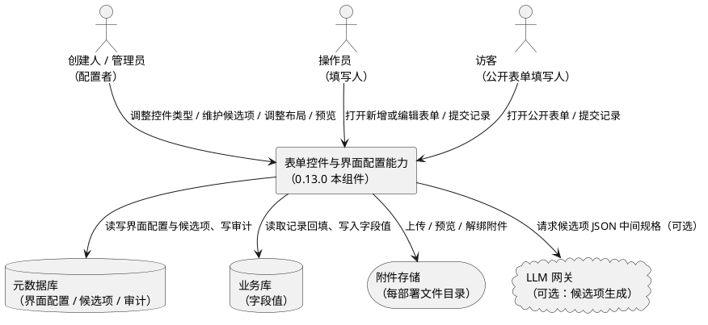
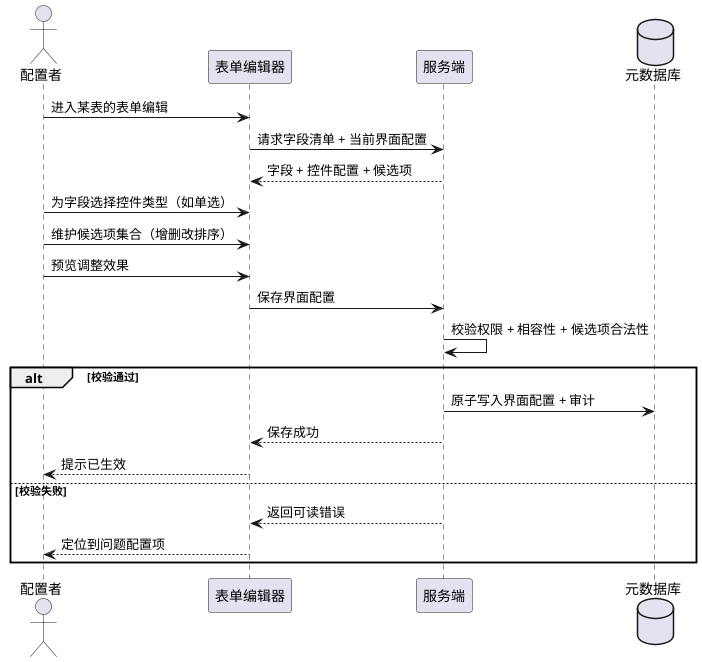
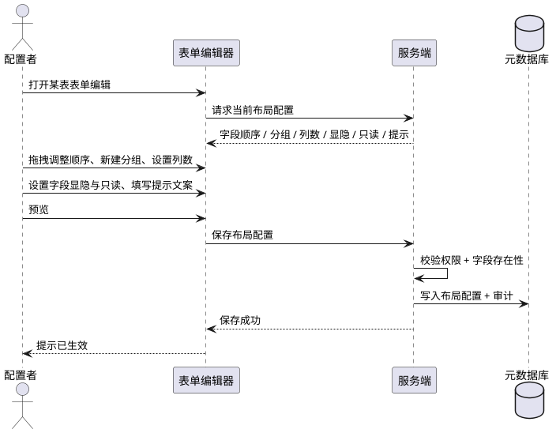
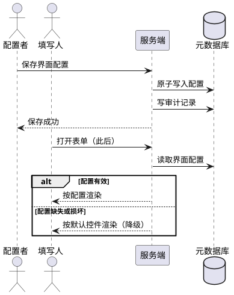

# DataMason 0.13.0 需求规格 — 表单控件能力与交互界面表单调整

> **基线**：0.12.0（M6 混合建库已交付）。本规格规划下一个次版本 **0.13.0**（里程碑 **M7**，编号由 DR-26/DR-34 预留）。
> **视角**：需求规格（What，不含 How）。设计实现由后续《技术方案与实现闭环》承接，任务拆分由《开发计划》承接。
> **配套**：本文件是 0.13.0 需求规格主件，落地于 `docs/规划/0.13.0/`；配套《决策记录》《技术方案与实现闭环》《开发计划》同目录。

---

# 1. 组件定位

## 1.1 核心职责

本组件负责把字段的数据语义翻译为合适的表单交互控件，并允许业务人员在运行态调整表单的呈现方式，实现"不写代码也能把表单调到贴合真实业务"。

## 1.2 核心输入

1. **表单打开请求**：工作台成员在 CRUD 列表页点击「新增 / 编辑」时，携带部署标识与目标表名。
2. **公开表单访问请求**：访客匿名打开公开提交页（`public_form`），携带部署标识与页面标识。
3. **字段控件配置调整指令**：业务人员在「界面与菜单」的表单编辑器中，对某表字段的控件类型、候选项集合、布局所做的修改。
4. **字段蓝图变更事件**：业务人员在「数据蓝图」中新增/删除/改名字段或改类型后，表单需要重算可用字段与控件。
5. **附件上传 / 移除请求**：表单内附件控件触发的文件上传与解绑操作。
6. **既有记录数据**：编辑场景下用于回填控件值的当前记录。
7. **选项集生成请求（可选能力）**：业务人员以自然语言描述候选项，请求生成候选选项集合。

## 1.3 核心输出

1. **渲染后的表单**：按字段控件配置呈现的控件序列、分组与栅格布局。
2. **保存请求载荷**：包含单选值、多选值集合、时间值、附件引用在内的字段值集合。
3. **字段控件配置持久化结果**：配置保存后重新打开表单时逐项一致。
4. **校验错误提示**：必填缺失、候选值非法、时间格式非法、附件超限等面向填写人的可读提示。
5. **附件引用**：已上传附件的标识写入目标记录字段。
6. **配置变更审计记录**：谁在何时把哪个字段的控件配置从什么改成了什么。
7. **配置影响预览**：调整生效前，向配置者展示该表表单调整后的样子。

## 1.4 职责边界

本组件**不负责**以下事项：

1. **不负责数据库结构变更**：字段的新增、删除、改名、改数据类型仍由「数据蓝图」的结构演化链路负责；表单调整只改呈现，不改存储结构。
2. **不负责条件联动与规则引擎**：「选 A 才显示 B」「字段间计算」等条件逻辑不在一期范围。
3. **不负责自定义样式与主题**：不提供 CSS 注入、字体/配色定制。
4. **不负责多语言**：沿用当前全中文硬编码文案口径。
5. **不负责附件二进制存储**：上传、预览、回收复用既有附件能力，本组件只负责表单内的交互与引用写入。
6. **不负责列表页列配置与仪表盘布局**：本组件仅覆盖表单（新增/编辑/公开提交）的呈现。
7. **不负责 LLM 直接产出控件配置**：LLM 至多产出候选项的 JSON 中间规格，控件类型与布局一律由确定性映射与人工配置决定。
8. **不负责权限模型**：谁能调整界面沿用既有三层角色与按人授权，本组件不新增权限概念。

---

# 2. 领域术语

**控件**
: 表单中承载单个字段输入的交互组件，例如文本框、数字框、下拉选择、单选组、多选组、日期时间选择器、附件上传器。

**控件类型**
: 一个字段在表单中采用的控件形态的标识；它由字段的数据类型与业务人员配置共同决定，是展示层概念，不改变字段的存储类型。

**候选项集合**
: 单选或多选控件可供选择的取值清单，由业务人员配置并持久化；每个候选项包含一个存储值与一个展示文案。
: 备注：候选项集合是展示层配置，其存储值写入字段的既有文本存储，不新建数据库表。

**单选字段**
: 在候选项集合中**有且仅有一个**取值被允许的字段。
: 备注：易混淆项——布尔字段也是"二选一"，但布尔是数据类型层面的既有语义，单选是展示层的候选项配置，两者应分别处理。

**多选字段**
: 在候选项集合中允许选取**零到多个**取值、且已选值需完整还原的字段。

**时间控件**
: 面向日期或日期时间语义的专用选择控件，替代当前以纯文本输入日期时间的做法，消除格式手误。
: 备注：一期包含「日期」与「日期时间」两种粒度，粒度属于控件配置。

**表单布局**
: 字段在表单中的排列方式，包括字段顺序、分组、每行列数、字段显隐与只读状态、辅助提示文案。

**界面配置**
: 针对某张表的表单所保存的控件类型、候选项集合与布局的总和；它与字段蓝图分离，字段蓝图变更不自动覆盖界面配置。

**字段蓝图**
: 业务库表结构的元数据视图（字段名、业务名、类型、长度、可空、主键、外键、唯一等），由「数据蓝图」维护。

**填写人**
: 在表单中录入数据的人；在工作台场景下是成员（创建人/管理员/操作员），在公开表单场景下是匿名访客。

**配置者**
: 调整表单控件与布局的人；一期限定为创建人与平台管理员。

---

# 3. 角色与边界

## 3.1 核心角色

1. **创建人**：部署该套系统的业务负责人；可调整本部署内所有表单的控件配置与布局，可维护候选项集合。
2. **管理员**：部署内的管理者；可调整本部署内表单配置，权限与创建人一致（沿用既有角色模型）。
3. **操作员**：业务数据的录入者；**不可**调整表单配置，仅作为填写人使用调整后的表单。
4. **访客**：公开表单的匿名填写人；仅可提交，不可查看数据，更不可调整配置。

## 3.2 外部系统

1. **业务库**：表单保存的字段值最终写入的物理库（SQLite / MySQL / PostgreSQL）；本组件只读写字段值，不改变其结构。
2. **元数据库**：持久化界面配置、候选项集合、审计记录与配置影响所依据的页面/表元数据。
3. **附件存储**：每部署独立的文件目录，承载附件二进制；表单附件控件通过既有附件能力与之交互。
4. **LLM 网关**：可选的候选项集合生成能力所依赖的 OpenAI 兼容端点；不可用时不影响手工配置路径。

## 3.3 交互上下文



---

# 4. DFX 约束

## 4.1 性能

1. **表单首屏**：在既有元数据已缓存的前提下，打开一个 20 字段以内的表单，从点击到可交互不超过 **1.5 秒**（不含附件预览下载）。
2. **配置保存**：单次界面配置保存的接口响应时间不超过 **1 秒**。
3. **候选项规模**：单个字段的候选项集合上限为 **200 项**；超过时配置界面必须拒绝保存并提示。
4. **附件上传**：单个附件大小上限沿用既有配置（默认 **10 MB**），表单必须在超限时**前置**给出提示，不发起上传。

## 4.2 可靠性

1. **配置一致性**：界面配置保存必须为原子操作；若保存失败，不得出现"部分字段生效、部分未生效"的中间状态。
2. **数据不丢失**：调整表单配置**禁止**影响已存在的业务记录数据；配置变更不得触发任何业务数据的改写或删除。
3. **降级可用**：当界面配置缺失、损坏或与当前字段蓝图不匹配时，表单必须降级为按字段数据类型的默认控件渲染，并保持可提交，不得白屏或阻断录入。
4. **回填保真**：编辑场景下，多选字段的已选值必须**完整**还原（不得丢失其中任一项）；单选字段的值必须准确选中对应候选项。
5. **附件解绑语义**：从表单移除附件仅解除该记录对附件的引用，附件本身按既有回收策略处理，不得误删仍被其他记录引用的附件。

## 4.3 安全性

1. **配置权限**：仅创建人与平台管理员可读写界面配置与候选项集合；操作员与访客的调整请求必须被拒绝并返回明确的权限错误。
2. **公开表单最小暴露**：公开表单仅下发其需要的字段与候选项，**禁止**下发任何其他表的字段、候选项或业务数据。
3. **候选项值校验**：服务端必须校验提交值属于该字段的候选项集合；**禁止**仅依赖前端控件限制。
4. **附件安全**：沿用既有扩展名与 MIME 白名单校验；表单不得绕过该校验直接落盘。
5. **审计留痕**：界面配置的变更必须记录操作人、时间、字段与变更前后的配置摘要。

## 4.4 可维护性

1. **配置可导出**：界面配置必须随部署导出产物一并导出，保证部署迁移后可复现。
2. **可观测**：配置保存失败、降级渲染、候选项生成失败必须产生可检索的错误记录。
3. **可诊断**：当表单渲染与配置不一致时，必须能定位到具体字段与配置项（错误信息包含表名与字段名）。

## 4.5 兼容性

1. **存量兼容**：0.13.0 之前部署的系统，在没有任何界面配置的情况下，表单表现必须与升级前**完全一致**（默认控件映射不变）。
2. **配置向后兼容**：新增的配置项必须允许缺省；缺省时按默认控件映射渲染。
3. **字段蓝图联动**：字段蓝图删除字段后，其残留界面配置必须被安全忽略（不得导致渲染报错）；字段蓝图新增字段时，必须以默认控件出现在表单中。
4. **不改存储结构**：本版本对业务库**禁止**产生任何 DDL 变更（含字段类型扩展）。

---

# 5. 核心能力

## 5.1 表单控件能力

### 5.1.1 业务规则

1. **默认控件映射不变**：系统必须为每种既有字段类型保留既有的默认控件映射（数字→数字框、长文本→多行文本、布尔→是否选择、外键→关联下拉、附件→附件控件），未配置时按此渲染。
   a. 验收条件：**When** 一张从未做过界面配置的表被打开新增表单，**the system shall** 按既有默认映射渲染全部字段。

2. **单选项控件**：当字段被配置为单选时，系统必须渲染单选控件（下拉选择或单选按钮组），且仅允许选取候选项集合中的一个值。
   a. 验收条件：**When** 填写人打开含单选字段的表单，**the system shall** 呈现的候选项与配置的候选项集合完全一致（数量、顺序、展示文案）。
   b. 验收条件：**When** 填写人选中某一候选项并保存，**the system shall** 只写入该候选项对应的存储值。
   c. 验收条件：**If** 提交值不在候选项集合中，**then the system shall** 拒绝保存并提示该字段取值非法。

3. **多选项控件**：当字段被配置为多选时，系统必须渲染多选控件（多选下拉或复选框组），允许选取零到多个候选项，且已选值在编辑时必须完整还原。
   a. 验收条件：**When** 填写人勾选三个候选项并保存，**the system shall** 完整持久化三个取值。
   b. 验收条件：**When** 填写人重新打开该记录，**the system shall** 准确勾选此前保存的三个候选项，不多不少。
   c. 验收条件：**If** 提交的候选项中包含非法值，**then the system shall** 拒绝保存并指明非法项。

4. **时间控件**：当字段被配置为时间控件时，系统必须渲染专用日期或日期时间选择器，替代纯文本输入，并保证取值格式与后端约定一致。
   a. 验收条件：**When** 填写人打开含日期时间字段的表单，**the system shall** 提供日期时间选择器而非自由文本输入。
   b. 验收条件：**When** 填写人选择「2026-09-23 14:30:00」，**the system shall** 以该值保存，且重新打开时选择器回显同一时刻。
   c. 验收条件：**Where** 字段配置为「日期」粒度，**the system shall** 仅允许选择日期，保存时按当日零点处理。
   d. 验收条件：**If** 填写人提交无法解析的时间文本，**then the system shall** 拒绝保存并提示格式要求。

5. **附件控件**：当字段类型为附件时，系统必须提供上传、预览、移除交互，并在表单中展示已绑定附件的可读名称。
   a. 验收条件：**When** 填写人上传一个合法文件，**the system shall** 将该附件的引用写入该字段，并在表单中展示其名称。
   b. 验收条件：**When** 填写人移除某个附件后保存，**the system shall** 使该记录不再引用该附件。
   c. 验收条件：**If** 上传文件扩展名或大小不合规，**then the system shall** 拒绝上传并提示具体原因。

6. **必填与候选的联合校验**：必填、候选项合法性、时间格式、附件限制必须同时生效，且**服务端**必须独立复核，不得仅依赖前端。
   a. 验收条件：**If** 填写人绕过前端直接提交非法载荷，**then the system shall** 在服务端拒绝并返回可读错误。

7. **禁止项**：禁止在表单调整中改变字段的存储类型或存储结构。
   a. 验收条件：**When** 配置者把某字段改为单选/多选/时间控件，**the system shall** 仅更新界面配置，且业务库结构保持不变。

8. **禁止项**：禁止在候选项集合中使用重复的存储值。
   a. 验收条件：**If** 配置者提交了两个存储值相同的候选项，**then the system shall** 拒绝保存并提示重复。

### 5.1.2 交互流程

```plantuml
@startuml
actor "填写人" as U
participant "表单组件" as F
participant "服务端" as S
database "业务库" as DB
storage "附件存储" as FS

U -> F : 打开新增/编辑表单
F -> S : 请求表单元数据 + 界面配置
S --> F : 字段清单 + 控件配置 + 候选项
F --> U : 按配置渲染控件
U -> FS : （附件字段）上传文件
FS --> U : 返回附件引用
U -> F : 填写并提交
F -> S : 提交字段值集合
S -> S : 服务端复核必填/候选/时间/附件
alt 校验通过
  S -> DB : 写入字段值
  S --> F : 保存成功
  F --> U : 提示成功并关闭
else 校验失败
  S --> F : 返回可读错误
  F --> U : 定位到出错字段并提示
end
@enduml
```

### 5.1.3 异常场景

1. **候选项集合为空**
   a. 触发条件：字段被配置为单选/多选，但候选项集合为空。
   b. 系统行为：降级为普通文本输入（或禁用并提示），不阻断表单其余字段。
   c. 用户感知：该字段显示"尚未配置候选项，请联系管理员"，保存时按普通文本处理。

2. **界面配置与字段蓝图不匹配**
   a. 触发条件：界面配置引用了已被删除的字段，或字段类型已变更。
   b. 系统行为：忽略失效配置项，对现存字段按默认映射渲染。
   c. 用户感知：表单正常可用；配置者侧可见"部分配置已失效"的提示。

3. **多选值超长**
   a. 触发条件：多选已选值序列化后超出该字段存储长度上限。
   b. 系统行为：拒绝保存并提示。
   c. 用户感知：提示"已选内容过长，请减少选择项或联系管理员加长字段"。

4. **附件上传失败**
   a. 触发条件：上传过程中网络中断或服务端拒绝。
   b. 系统行为：不写入附件引用，保持字段原值不变。
   c. 用户感知：提示上传失败原因，可重试。

5. **附件引用指向已失效附件**
   a. 触发条件：编辑记录时，其附件引用对应的文件已不存在。
   b. 系统行为：展示为"附件已失效"占位，不阻断保存。
   c. 用户感知：该附件条目显示失效状态，可移除后重新上传。

6. **候选项生成失败（可选能力）**
   a. 触发条件：调用 LLM 生成候选项时超时或返回不合法结构。
   b. 系统行为：不写入任何候选项，保留原有配置。
   c. 用户感知：提示生成失败，引导手工录入。

7. **并发修改冲突**
   a. 触发条件：两名配置者同时修改同一张表的界面配置。
   b. 系统行为：后提交者覆盖前提交者，并在审计中留存两次变更。
   c. 用户感知：保存成功后提示"该配置已被他人修改过，当前为你本次保存的内容"。

---

## 5.2 字段控件类型配置

### 5.2.1 业务规则

1. **可选控件类型**：系统必须为业务人员提供明确的控件类型选项，至少覆盖：单行文本、多行文本、数字、布尔、单选、多选、日期、日期时间、关联选择、附件。
   a. 验收条件：**When** 配置者打开某字段的控件配置，**the system shall** 列出上述控件类型，并标注当前生效项。

2. **控件类型与数据类型的相容约束**：系统必须限制控件类型与字段数据类型的相容组合，禁止将数值字段配置为附件控件等不相容组合。
   a. 验收条件：**If** 配置者选择与字段数据类型不相容的控件类型，**then the system shall** 拒绝该选择并说明原因。
   b. 验收条件：**Where** 字段为数值类型，**the system shall** 仅允许数字、单选、多选等相容控件。

3. **候选值来源**：单选与多选控件的候选项必须可持久化维护，支持增、删、改、排序，且每个候选项包含存储值与展示文案。
   a. 验收条件：**When** 配置者新增一个候选项（存储值 + 展示文案）并保存，**the system shall** 在下次打开表单时呈现该候选项。

4. **候选值来源（可选能力）**：系统应当支持以自然语言描述生成候选项候选清单，且生成结果必须经配置者确认后才写入配置。
   a. 验收条件：**When** 配置者以自然语言请求生成候选项，**the system shall** 返回候选清单供其勾选，**且**未确认前不得写入配置。

5. **配置可回退**：系统必须支持将某字段的控件配置恢复为默认（按数据类型映射）。
   a. 验收条件：**When** 配置者执行"恢复默认"，**the system shall** 清除该字段的自定义控件配置，表单回到默认渲染。

6. **配置可预览**：配置者在保存前必须能够预览该表表单调整后的呈现效果。
   a. 验收条件：**When** 配置者调整控件类型或布局，**the system shall** 提供预览，且预览与实际表单渲染一致。

7. **禁止项**：禁止通过控件配置改变字段的数据类型或存储长度。
   a. 验收条件：**When** 配置者保存控件配置，**the system shall** 不产生任何业务库结构变更。

8. **禁止项**：禁止操作员与访客读写字段控件配置。
   a. 验收条件：**If** 操作员或访客发起配置读写请求，**then the system shall** 返回权限错误。

### 5.2.2 交互流程



### 5.2.3 异常场景

1. **不相容控件类型**
   a. 触发条件：配置者选择了与字段数据类型不相容的控件。
   b. 系统行为：前端即时禁用或服务端拒绝。
   c. 用户感知：提示"该控件不适用于此字段类型"。

2. **候选项存储值重复或为空**
   a. 触发条件：候选项的存储值为空或与同组其他项重复。
   b. 系统行为：拒绝保存。
   c. 用户感知：定位到具体候选项并提示原因。

3. **候选项超过上限**
   a. 触发条件：候选项数量超过 200。
   b. 系统行为：拒绝保存。
   c. 用户感知：提示"候选项数量已达上限 200"。

4. **权限不足**
   a. 触发条件：非创建人/管理员尝试保存配置。
   b. 系统行为：服务端拒绝，不产生任何写入。
   c. 用户感知：返回权限错误提示。

5. **配置保存冲突**
   a. 触发条件：保存过程中配置已被他人更新。
   b. 系统行为：按后写覆盖，并记录审计。
   c. 用户感知：提示配置已被他人修改，当前以本次保存为准。

---

## 5.3 表单布局与展示调整

### 5.3.1 业务规则

1. **字段顺序调整**：配置者必须能够调整字段在表单中的排列顺序，且该顺序在保存后保持。
   a. 验收条件：**When** 配置者把"备注"字段从末位调整到第 2 位并保存，**the system shall** 在后续打开表单时按新顺序渲染。

2. **字段分组**：配置者应当能够把字段划分为若干分组，表单按分组分段展示。
   a. 验收条件：**When** 配置者创建"基本信息"与"联系方式"两个分组并归类字段，**the system shall** 在表单中按分组分节呈现。

3. **每行列数**：配置者应当能够设置表单的每行列数（如单列、双列），影响字段的排布密度。
   a. 验收条件：**When** 配置者将表单设为双列，**the system shall** 在可用宽度下按两列排布字段。

4. **字段显隐**：配置者必须能够将字段设为在表单中隐藏；隐藏字段不得在表单中出现，但其既有数据不得被破坏。
   a. 验收条件：**When** 某字段被设为隐藏后保存，**the system shall** 在表单中不再展示该字段，**且**该字段的既有记录值保持不变。

5. **只读展示**：配置者必须能够将字段设为只读；只读字段在表单中展示但不可编辑，其值在提交时保持原样。
   a. 验收条件：**When** 某字段被设为只读，**the system shall** 展示其当前值且禁止修改，提交时不得改变该值。

6. **辅助提示文案**：配置者应当能够为字段配置辅助提示（如填写说明），在表单中随字段展示。
   a. 验收条件：**When** 配置者为字段填写提示文案，**the system shall** 在该字段旁展示该提示。

7. **布局调整的作用范围**：布局调整必须作用于该表的新增表单与编辑表单；公开表单的布局调整应当单独可控（公开表单只暴露其需要的字段）。
   a. 验收条件：**When** 配置者调整某表表单布局，**the system shall** 使工作台新增与编辑表单同步生效。

8. **禁止项**：禁止通过布局调整删除字段或改变其数据类型。
   a. 验收条件：**When** 配置者隐藏某字段，**the system shall** 保留该字段在字段蓝图与业务库中的存在。

9. **禁止项**：禁止将主键字段与系统归属字段纳入可调整的表单字段范围。
   a. 验收条件：**When** 配置者打开表单编辑器，**the system shall** 不呈现主键与归属列作为可调项。

### 5.3.2 交互流程



### 5.3.3 异常场景

1. **配置引用已删除字段**
   a. 触发条件：布局配置中的字段在字段蓝图中已被删除。
   b. 系统行为：忽略该配置项，其余布局正常生效。
   c. 用户感知：表单正常渲染；配置者侧提示存在失效配置项。

2. **隐藏了必填字段**
   a. 触发条件：配置者将必填字段设为隐藏。
   b. 系统行为：提示该字段为必填，隐藏后新增记录可能无法提交，需确认。
   c. 用户感知：确认提示；确认后保存，但新增表单提交时给出明确的必填缺失提示。

3. **列数与字段数不匹配**
   a. 触发条件：设为多列但字段数很少或分组内字段数为 0。
   b. 系统行为：按可用字段自适应排布，空分组不展示。
   c. 用户感知：表单正常渲染，无空白异常区域。

4. **布局配置损坏**
   a. 触发条件：布局配置无法解析。
   b. 系统行为：降级为默认单列布局。
   c. 用户感知：表单可用；配置者侧提示"布局配置已重置为默认"。

---

## 5.4 配置的持久化、生效与治理

### 5.4.1 业务规则

1. **配置持久化**：界面配置（控件类型、候选项集合、布局）必须持久化于元数据库，与字段蓝图分离存放。
   a. 验收条件：**When** 配置者保存界面配置后重新登录，**the system shall** 完整回读该配置。

2. **配置与字段蓝图解耦**：字段蓝图的结构演化不得自动清除界面配置；仅当字段被删除时，其对应配置失效。
   a. 验收条件：**When** 在「数据蓝图」新增一个字段，**the system shall** 以默认控件把新字段加入表单，**且**不改变其他字段已有的界面配置。

3. **配置随部署导出**：界面配置必须随部署导出产物一并导出，且导出内容包含候选项集合与布局。
   a. 验收条件：**When** 导出该部署，**the system shall** 在导出产物中包含界面配置。

4. **变更审计**：界面配置的每次变更必须记录操作人、时间、目标表与字段、变更摘要。
   a. 验收条件：**When** 配置者修改某字段的控件类型，**the system shall** 产生一条可检索的审计记录。

5. **配置生效时机**：配置保存成功后必须立即对后续打开的表单生效，无需重启或重新部署。
   a. 验收条件：**When** 配置保存成功，**the system shall** 使下一次打开的表单即采用新配置。

6. **降级不阻断**：任何配置读取或解析失败都必须降级为默认渲染，禁止阻断填写人的正常录入。
   a. 验收条件：**If** 配置读取超时或异常，**then the system shall** 以默认控件渲染表单并保持可提交。

7. **禁止项**：禁止在未保存的情况下使配置对填写人可见（草稿不得泄漏给填写人）。
   a. 验收条件：**When** 配置者在编辑器中调整但未保存，**the system shall** 使填写人看到的表单保持不变。

### 5.4.2 交互流程



### 5.4.3 异常场景

1. **配置写入失败**
   a. 触发条件：持久化过程中发生错误。
   b. 系统行为：整体回滚，不产生部分生效。
   c. 用户感知：提示保存失败，原配置保持有效。

2. **导出遗漏配置**
   a. 触发条件：导出产物缺少界面配置。
   b. 系统行为：导出流程报错并中止，不得产出不完整产物。
   c. 用户感知：提示导出失败原因。

3. **配置读取权限越界**
   a. 触发条件：操作员或访客请求他人表的配置。
   b. 系统行为：拒绝并返回权限错误。
   c. 用户感知：无配置数据泄漏。

---

# 6. 数据约束

## 6.1 字段控件配置

1. **所属部署**：必须关联唯一的部署，禁止跨部署引用。
2. **所属表与字段**：必须指向该部署内的表与字段；引用的字段必须存在。
3. **控件类型**：必须取自约定的控件类型集合（单行文本、多行文本、数字、布尔、单选、多选、日期、日期时间、关联选择、附件）。
4. **相容性**：控件类型必须与该字段的数据类型相容；不相容组合禁止持久化。
5. **是否自定义**：必须能区分"已自定义"与"沿用默认"；沿用默认时不存储具体控件类型。
6. **时间粒度**：时间控件必须能表达「日期」或「日期时间」粒度。
7. **是否只读**：必须能表达该字段在表单中是否只读。
8. **是否隐藏**：必须能表达该字段在表单中是否隐藏。
9. **提示文案**：可为空；非空时长度不超过 200 个字符。
10. **唯一性**：同一部署、同一表、同一字段至多存在一条控件配置。

## 6.2 候选项集合

1. **所属字段**：必须关联到一个单选或多选字段。
2. **存储值**：必填，长度不超过 100 个字符，同一字段内唯一。
3. **展示文案**：必填，长度不超过 100 个字符。
4. **排序**：必须支持显式顺序，表单按该顺序展示候选项。
5. **数量上限**：单字段候选项数量不超过 200。
6. **删除语义**：删除候选项不得影响已保存记录中的历史值（历史值在编辑时按"已失效取值"处理，可提示但不得导致报错）。

## 6.3 表单布局

1. **所属表**：必须关联到该部署内的一张表。
2. **字段顺序**：必须完整覆盖该表所有可调字段（主键与归属列除外）的相对顺序。
3. **分组**：分组名称不超过 50 个字符；分组数量不超过 20；同一字段至多属于一个分组。
4. **每行列数**：取值必须为 1、2 或 3。
5. **字段显隐与只读**：必须与字段控件配置中的对应项保持一致（单一数据源，禁止两处冲突）。
6. **公开表单布局**：必须与工作台表单布局分别存储，公开表单只可包含允许公开的字段。

## 6.4 配置变更审计记录

1. **操作人**：必须记录触发变更的用户。
2. **时间**：必须记录变更发生时刻。
3. **目标**：必须记录部署、表、字段（或布局范围）。
4. **变更摘要**：必须能表达变更前后的配置差异要点。
5. **不可篡改**：审计记录禁止被普通业务操作修改或删除。

---

*规格版本：0.13.0 需求规格 v1 ｜ 视角：需求（What） ｜ 基线：0.12.0（M6 已交付）｜ 主题：表单控件能力与交互界面表单调整 ｜ 里程碑：M7 ｜ 归档：`.codeartsdoer/specs/form_controls_ui/`、`docs/规划/0.13.0/`*